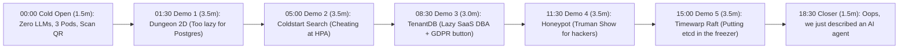
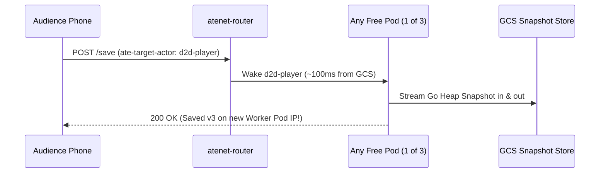

# Talk Outline: "Running Anything *But* Agents on Agent Substrate"

## Final CFP Abstract

> Agent Substrate is for agents. It is right there in the name. Or is it? Strip away the LLM orchestration frameworks, and what you are left with is a systems engineer's dream: an ultra-high-density, multi-tenant sandboxing platform built on Kubernetes that bypasses standard Pod lifecycle constraints.
>
> What happens when we hijack these primitives for workloads that have absolutely nothing to do with AI? In this talk, we will explore the limits of Substrate by utilizing its core building blocks: native process-level suspend/resume, rapid rehydration, and pod-decoupled scaling.
>
> Through this exercise of "unconventional systems-engineering design patterns" we'll look at the good ideas, the terrible ideas, and how pushing this infrastructure to its limits helps us all gain a better understanding of why these exact primitives make Substrate the perfect foundation for the agentic era.

## Stage Philosophy (20 Minutes Total)

1. **Show first, explain after:** Zero architecture lecture slides at the beginning. Open with a 90-second dare, flash the QR code, and spend 16 of the 20 minutes inside live demos. Let the audience watch something ridiculous work on screen *first*, then spend 45 seconds pulling back the curtain on which Substrate feature made it happen.
2. **Keep it light and funny:** Frame the talk as a lazy, slightly mischievous systems engineer committing five escalating "infrastructure crimes" on **three tiny 1-vCPU pods** (`manifests/workerpool.yaml.tmpl`) just to avoid writing boilerplate, waiting on cold boots, or getting paged.
3. **Repeatable 3-beat rhythm for every demo:**
   - **The Premise / Joke (15s):** Why a lazy engineer tried this.
   - **Live Show-Don't-Tell (~2m):** Click through the live UI so the room sees the behavior firsthand.
   - **What the Demo Does + What Substrate Gives Us (~45s):** Name what the app actually does and the exact Agent Substrate primitives we got for free.

## 20-Minute Run of Show

| Time | Segment | Duration | Live Screen | Substrate Features Unlocked |
|---|---|---|---|---|
| `00:00` | **Cold Open: Slides on Substrate & Zero Tokens** (`cmd/slides`) | `1.5 min` | `https://abs.slides.substrate.learngke.dev/deck` + `workerpool.yaml.tmpl` | 12 sleeping slide actors, 0/3 workers held when idle, live heap state |
| `01:30` | **Demo 1: "I Was Too Lazy to Set Up Postgres"** (`cmd/dungeon2d`) | `3.5 min` | `https://dungeon.substrate.learngke.dev/dashboard` + `/play` | `SNAPSHOT_FIDELITY_MEMORY`, `atenet` Wake-on-HTTP, `revert`, `--tag` |
| `05:00` | **Demo 2: "Cheating at the Autoscaling Olympics"** (`cmd/coldstart`) | `3.5 min` | `https://coldstart.substrate.learngke.dev/dashboard` | `ActorTemplate` + `wakeupProbe` Golden Snapshots, ~100ms heap clone |
| `08:30` | **Demo 3: "The Lazy DBA's Multi-Tenant SaaS"** (`cmd/tenantdb`) | `3.0 min` | `https://tenantdb.substrate.learngke.dev/dashboard` | `DurableDir` (`/data`), async hot-RAM vs. sync WAL suspend, `delete actor` |
| `11:30` | **Demo 4: "The Truman Show for Hackers"** (`cmd/honeypot`) | `3.5 min` | `https://honeypot.substrate.learngke.dev/` | `gVisor` sandboxing, rootfs overlay snapshots, anti-`rm -rf` `revert` + `--tag` |
| `15:00` | **Demo 5: "Putting Raft in the Freezer"** (`cmd/timewarp`) | `3.5 min` | `https://timewarp.substrate.learngke.dev/dashboard` | Wall-clock jump behavior across `suspend`/`resume`, `?guard=true` fencing |
| `18:30` | **The Twist: "Wait, That's an AI Agent"** | `1.5 min` | 5-row synthesis slide | Why combining Demos 1-4 (and avoiding Demo 5) defines agentic infra |

## Pre-Stage Setup Checklist

1. **Cluster & Golden Snapshots (`v1.0.0-rc.2`):** Confirm `kubectl get workerpool anything-but-agents -n anything-but-agents` shows `3/3` ready `ateworker-gvisor` pods and `kubectl ate get actor-templates -a anything-but-agents` has `goldenTag` populated on all templates.
2. **Browser tabs pre-opened left-to-right (sign in once with Google on Tab 0 to unlock all 6 tabs via cross-subdomain SSO, and click the top-right Sun icon for Projector Light Mode if the room is bright):**
   - Tab 0: `https://abs.slides.substrate.learngke.dev/deck` (Live Slide Deck)
   - Tab 1: `https://dungeon.substrate.learngke.dev/dashboard` (with QR modal open!) + mobile `/play` tab
   - Tab 2: `https://coldstart.substrate.learngke.dev/dashboard`
   - Tab 3: `https://tenantdb.substrate.learngke.dev/dashboard`
   - Tab 4: `https://honeypot.substrate.learngke.dev/`
   - Tab 5: `https://timewarp.substrate.learngke.dev/dashboard`
3. **Clear stuck actors before walking on stage:** Run `./hack/stage-demo.sh act1-dungeon` once or check `kubectl ate get actors -a anything-but-agents` so all 3 worker slots start free.

## Minute-by-Minute Show Flow

### Cold Open: Zero Tokens, Three Pods (`00:00 - 01:30`)

* **On screen:** Title card for 15 seconds, then straight to Tab 1 (`dungeon2d` `/dashboard` with the giant QR code open next to `replicas: 3` from `manifests/workerpool.yaml.tmpl`).
* **Light spoken hook:**
  * *"Every other talk this week has an LLM in it. I promise you zero tokens, zero prompts, and zero chatbots for the next 20 minutes."*
  * *"Agent Substrate has 'Agent' right there in the name, so people assume it is an AI framework. Strip the AI away, and it is really a machine for freezing Linux processes in mid-air and waking them up on any pod in 100 milliseconds."*
  * *"Also, I am cheap. So I only provisioned **three** 1-CPU worker pods for this entire talk. Scan that QR code right now, pick a class, and start playing. Let's see how many bad ideas we can cram onto three pods before something catches fire."*

### Demo 1: "I Was Too Lazy to Set Up Postgres" (`01:30 - 05:00`, `cmd/dungeon2d`)

* **The Joke / Setup (15s):**
  * *"Think about how much of our lives we waste turning Go structs into SQL rows before an HTTP request finishes, and turning SQL rows back into Go structs 200ms later. For Demo 1, I asked: what if I just... didn't use a database?"*
* **Show, Don't Tell (2m 15s live in Tab 1):**
  1. **Close the QR modal to reveal the Live Leaderboard:** Point at the screen: 20 to 50 people in the audience are playing an 8-floor roguelike right now, and all of them are sharing **3 pods** (`0` pods used while they run around at 60fps in the browser; an actor only wakes up for ~100ms when someone hits a Save Shrine!). Point out `pod_ip_history`: players hop from pod IP to pod IP between saves without losing a single gold coin.
  2. **Die on purpose:** Take your hero on Floor 8 straight into the **Ancient Heap Dragon** without fire protection -> `HP = 0`, dead on screen.
  3. **Save-Scum like a shameless gamer:** Click **Revert** (`kubectl ate revert actor d2d-mofi --snapshot-version`). Boom: alive again before the boss room! That was `git reset --hard` on live Go heap memory.
  4. **Cheat at a mutually exclusive choice:** Floor 6 has two locked chests and one key (`sunforged-aegis` vs. `voidbane-relic`). Click **Fork Timeline** (`--tag`) to clone your frozen memory into a parallel universe so you can open both.
* **What the Demo Does & What Substrate Gives Us (1m):**
  * **What the demo does:** Runs a multi-player 8-floor dungeon crawler where `100%` of server persistence is ordinary Go structs (`WorldState` / `ActorSession`) sitting in RAM, with zero SQL drivers, Redis clients, or files on disk.
  * **Features we get from Substrate:**
    * **`WorkerPool` + `atenet` Wake-on-HTTP:** An HTTP header (`ate-target-actor`) wakes a sleeping process on whichever of the 3 pods is free in ~100ms (and parks requests briefly if all 3 are busy), turning 3 pods into capacity for the whole room.
    * **Process Memory Checkpointing (`SNAPSHOT_FIDELITY_MEMORY`):** Freezes the Go heap and goroutine state to GCS when idle and restores it onto a totally different pod IP later.
    * **`kubectl ate revert` & `kubectl ate create tag` (`--tag`):** Infrastructure-level undo and branching timelines with zero application rollback code.

* **Transition joke to Demo 2:**
  * *"Okay, I can hear the backend engineers thinking: 'Cute game, Mofi, I don't run dungeons at work, I run serious stateless services behind HorizontalPodAutoscaler.' Great! Let's race."*

### Demo 2: "Cheating at the Autoscaling Olympics" (`05:00 - 08:30`, `cmd/coldstart`)

* **The Joke / Setup (15s):**
  * *"Who here runs a 'stateless' Java app, Python ML service, or search engine that takes 12+ seconds to boot before `/readyz` turns green? When traffic spikes, HPA panics and adds pods, and your new pods spend 12 seconds doing yoga while Pod 1 catches fire."*
* **Show, Don't Tell (2m 15s live in Tab 2):**
  1. **Show the contestants:** A real 50,000-package BM25 + trigram code search engine (~76 MB Go heap, capped at `20 QPS` per pod) that takes **12 seconds** across 6 startup stages to build its in-memory index. Click **Probe Both Backends** to show `coldstart-1` and `coldstart-2` returning real search hits with the **exact same `golden_heap_fingerprint`**.
  2. **Hit the `60 QPS` Spike button (`1 -> 3` replicas):** Watch the oscilloscope and 6-stage LED matrix live!
     * **Top track (Standard K8s HPA):** Pods 2 and 3 sit at `503` slowly ticking through `Stage 1/6... 2/6...` for 12 agonizing seconds while Pod 1 drowns in red `429 Too Many Requests` crosshatch.
     * **Bottom track (Substrate HPA):** Actors 2 and 3 wake up in **~100ms** with the 50,000-doc index *already built in RAM*, jumping straight to `60 QPS` and serving ~2x the total queries!
* **What the Demo Does & What Substrate Gives Us (1m):**
  * **What the demo does:** Races standard Kubernetes HPA against Substrate under a `3x` traffic spike on a heavy 50,000-document in-memory search engine.
  * **Features we get from Substrate:**
    * **`ActorTemplate` + `wakeupProbe` Golden Snapshots:** Substrate runs the 12-second index build **once** when you register the template, waits for `/readyz == 200 OK`, and freezes that warm 76 MB heap into a Golden Snapshot (`goldenTag`).
    * **Cluster-Wide `fork()` & Pod-Decoupled Scaling:** Scaling from `1 -> 3` stamps out pre-warmed clones onto warm worker pods in ~100ms instead of repeating deterministic startup work on every scale-out event.

* **Transition joke to Demo 3:**
  * *"Photocopying 76 MB of read-only RAM is awesome. Know what is less awesome? Uploading 10,000 giant RAM caches to GCS every night when your SaaS customers go to bed."*

### Demo 3: "The Lazy DBA's Multi-Tenant SaaS" (`08:30 - 11:30`, `cmd/tenantdb`)

* **The Joke / Setup (15s):**
  * *"Every SaaS engineer has two nightmares: forgetting `WHERE tenant_id = ?` on a SQL query, and getting a GDPR 'delete all my data' ticket across 50 foreign-key tables on Friday at 4:55 PM. So I gave every customer their own private database binary... on our same 3 pods."*
* **Show, Don't Tell (2m live in Tab 3):**
  1. **Four DBs, Three Pods, Zero `tenant_id`:** Show `db-acme`, `db-globex`, `db-initech`, and `db-umbrella` multiplexing across the 3 worker slots. Every query is literally `SELECT * FROM tenant_records` because each tenant lives in its own isolated sandbox!
  2. **The Storage vs. RAM X-Ray:** Warm up `db-acme`'s `16.0 MB` RAM Buffer Pool. Click **Quick Suspend (`--mode=async`)** -> query it: `HOT_RAM_RESUME` (the 16 MB cache stayed hot!). Now click **Cold Hibernate (`--mode=sync`)** -> watch the 16 MB scratch cache evaporate so only the **`~480 B` `/data/wal.jsonl`** uploads to GCS (**`99.997%` bandwidth saved**!), replaying in `<1ms` on the next click.
  3. **The Friday 4:55 PM GDPR Button:** Acme Corp churns and demands GDPR deletion. Click **GDPR Shred** (`kubectl ate delete actor db-acme`): compute, RAM snapshots, and `/data` volume are vaporized in one command (`404 TENANT_SHREDDED`) while `db-globex` next door doesn't drop a beat.
* **What the Demo Does & What Substrate Gives Us (45s):**
  * **What the demo does:** Runs a dedicated embedded database + 16 MB buffer pool per SaaS customer without Kubernetes PVC attach bottlenecks or giant object-storage bills.
  * **Features we get from Substrate:**
    * **`DurableDir` Micro-Volumes (`volumes: [{durableDir: {}}]`):** Snapshot-backed `/data` directories that attach and detach in ~100ms across thousands of tenants (unlike K8s PVCs, which cap out at tens per node and take seconds/minutes to mount).
    * **Hot-RAM (`--mode=async`) vs. Compact Durable (`--mode=sync`) Suspend:** Keep RAM warm during active bursts, drop rebuildable caches for long hibernation.
    * **1-Command Tenant Shredding (`kubectl ate delete actor`):** Per-customer blast radius and instant cryptographic/storage cleanup.

* **Transition joke to Demo 4:**
  * *"Acme and Globex were polite paying customers. What happens when the user connecting to your app is an active hacker running `rm -rf`?"*

### Demo 4: "The Truman Show for Hackers" (`11:30 - 15:00`, `cmd/honeypot`)

* **The Joke / Setup (15s):**
  * *"Security honeypots usually suck: real VMs cost a fortune to leave idle, and fake Python shell emulators fool nobody. With Substrate, every sketchy IP address gets its own private *Truman Show* movie set."*
* **Show, Don't Tell (2m 30s live in Tab 4):**
  1. **Left ("The Movie Set") vs. Right ("The Director's Booth"):** On the left terminal, pretend to be Attacker `203.0.113.5` poking around an "exposed AcmeCorp Payroll console." Run real `/bin/sh` commands: `cat payroll_db_credentials.env.bak` and drop `/tmp/honeypot/dropper.sh`. Point to the right pane: silent SOC telemetry confirms `Linux 4.19.0-gvisor`, logs Canary alerts, hashes `dropper.sh`, and suspends the crime scene to GCS (`$0` idle cost while a second attacker IP gets a clean box!).
  2. **The Attacker Panics (`rm -f`):** Reconnect as `203.0.113.5` (it wakes in ~100ms on a *different* pod IP with `dropper.sh` still sitting in `/tmp`!). Run `rm -f dropper.sh` to destroy the evidence. The SOC pane flashes `ANTI_FORENSIC_WIPE_ATTEMPT (DELETED)`.
  3. **Un-deleting `rm -rf` & Secret Cloning:** Click **Revert Wipe** (`kubectl ate revert actor`) in the SOC booth -> the container filesystem rewinds and **`dropper.sh` pops right back onto disk**! Then click **Clone to Forensic Lab** (`--tag`) to spin up an identical copy of the compromised container for malware detonation while the hacker keeps typing on the left, totally clueless.
* **What the Demo Does & What Substrate Gives Us (45s):**
  * **What the demo does:** Gives every attacker IP a dedicated Linux shell environment with `$0` idle cost, invisible SOC telemetry, un-deletable evidence, and live sandbox cloning.
  * **Features we get from Substrate:**
    * **Native `gVisor` Isolation (`sandboxClasses: [gvisor]`):** Real `/bin/sh` Linux binaries trapped inside a user-space application kernel (`ateworker-gvisor`), solving the VM-security vs. `$0`-idle vs. 100ms-wakeup trilemma.
    * **Rootfs Overlay + RAM Persistence:** Even ephemeral `/tmp` edits survive suspend/resume across different GKE worker pods without a PVC.
    * **Forensic Time-Travel (`revert` + `--tag`):** Rewind destructive filesystem mutations or fork a live container Copy-on-Write to debug/inspect it safely on the side.

* **Transition joke to Demo 5 (Maximum Hubris):**
  * *"Pause and admire our ego right now. We deleted Postgres! We humiliated HPA! We solved GDPR and un-deleted `rm -rf`! At this point every engineer in the room has the same intrusive thought: 'Put EVERYTHING on Substrate! Let's put `etcd` and Raft on Substrate so our control plane scales to zero!' ... Let's watch how fast that ruins your weekend."*

### Demo 5: "Putting Raft in the Freezer" (`15:00 - 18:30`, `cmd/timewarp`)

* **The Joke / Setup (15s):**
  * *"You don't really understand a shiny new hammer until you smash your own thumb with it. Let's freeze the leader of a distributed consensus cluster."*
* **Show, Don't Tell (2m 15s live in Tab 5):**
  1. **Happy Cluster:** `raft-node-1..3` are up. `raft-node-1` is `LEADER (Term 1)` with a 3-second lease; Alice holds exclusive lock `#101`. Both clocks tick together.
  2. **Put Leader 1 in the Freezer:** Click **Suspend Term 1 Leader** (`kubectl ate suspend actor raft-node-1 --mode=sync`). Its CPU instructions drop to `0` and its heap clock freezes flat in amber. Count 3 seconds out loud: its lease expires in the real universe! `raft-node-2` and `raft-node-3` elect **`raft-node-2` as `LEADER (Term 2)`** and give exclusive lock `#102` to Bob.
  3. **Wake the Zombie:** Send a write from Mallory to `raft-node-1`. `atenet` cheerfully wakes `raft-node-1` up in 100ms! Because its frozen brain has no idea 5 seconds passed, three explosions happen in one tick:
     * **5,000ms Clock-Jump Shock** on a 100ms ticker.
     * **Dual-Leader Split-Brain:** `raft-node-1` still thinks it is `LEADER (Term 1)` and hands lock `#101` to Mallory while Bob holds `#102` on Node 2, corrupting the KV store on screen!
     * **Token-Bucket Jackpot:** `tokens += elapsed * rate` mints `+500` burst tokens at once.
  4. **The Seatbelt (`?guard=true`):** Toggle **Clock-Jump Guardrail ON** and replay: now on wakeup the process sees `dt >> 100ms`, immediately fences its stale lease (`409 Conflict`), and clamps its rate limiter.
* **What the Demo Does & What Substrate Gives Us (1m):**
  * **What the demo does:** Intentionally split-brains a 3-node Raft & distributed lock cluster by suspending its leader across a lease timeout, then fixes the wakeup shock with a clock-jump fence.
  * **What we learn about Substrate:**
    * **Substrate freezes process RAM, never the universe's wall clock:** Any actor holding external leases, OAuth tokens, or `time.Since(lastTick)` rate limiters must check for wall-clock jumps on wakeup.
    * **Know what stays on plain Kubernetes:** Consensus voters (`etcd`, Raft), continuous brokers (`Kafka`), and 100% duty-cycle 60Hz game loops belong on `StatefulSets` and `Deployments`.

### The Closer: "Wait... We Just Built an AI Agent by Accident" (`18:30 - 20:00`)

* **On screen:** One single punchline scorecard stacking all 5 demos together.
* **Spoken closer:**
  * *"Look at our five weird non-AI experiments on those three little pods:"*
    1. **Dungeon 2D:** Messy working memory that needs **checkpoint, undo (`revert`), and parallel branching (`--tag`)**.
    2. **Coldstart Search:** Heavy 12-second runtimes and indexes that need **100ms `Golden Snapshot` cloning**.
    3. **TenantDB:** Thousands of isolated per-user `/data` workspaces (`DurableDir`) that **burst for 5 seconds, then sit idle for 20 minutes** while a human thinks.
    4. **Honeypot:** Untrusted `/bin/sh` execution (`gVisor`) where someone *will* eventually hallucinate `rm -rf`.
    5. **Timewarp Raft:** Driven by **discrete request/turn bursts**, never a continuous 100ms consensus heartbeat.
  * **Final punchline:**
    > *"Put a save-scumming gamer, a slow-booting search index, an idle per-user workspace, and a chaotic `/bin/sh` user in a trench coat... and you just described an **AI agent**. Agent Substrate isn't 'for agents' because someone slapped an LLM logo on Kubernetes. It is the foundation for agents because an agent is the first mainstream workload in history that needs **all four** of those systems superpowers at once."*

## Quick Reference: Demo-to-Substrate Feature Cheat Sheet

| Demo | What the Demo Does | Features We Get from Substrate (`v1.0.0-rc.2`) |
|---|---|---|
| **0. `cmd/slides`** | Presentation deck where each slide is an actor sleeping in GCS | 12 sleeping slide actors, 0/3 workers held when idle, `SNAPSHOT_FIDELITY_MEMORY` heap views + `kubectl ate revert` |
| **1. `cmd/dungeon2d`** | Multi-player 8-floor browser roguelike with zero DB code | `WorkerPool` (`ate.dev/v1`), `atenet` Wake-on-HTTP, `SNAPSHOT_FIDELITY_MEMORY`, `save` / `--snapshot-version`, `revert`, `create tag` + `--tag` |
| **2. `cmd/coldstart`** | 50k-doc in-memory search engine in a `60 QPS` HPA race | `ActorTemplate` + `wakeupProbe` (`/readyz` -> `goldenTag` Golden Snapshot), ~100ms Copy-on-Write heap restore, pod-decoupled scaling |
| **3. `cmd/tenantdb`** | 1 isolated DB + 16 MB cache per customer across 3 pods | `DurableDir` (`/data`), `suspend --mode=async` (hot RAM) vs. `--mode=sync` (compact WAL, `99.997%` GCS saved), 1-cmd `delete actor` |
| **4. `cmd/honeypot`** | Per-IP `gVisor` hacker Movie Set + SOC forensic booth | `sandboxClasses: [gvisor]` (`ateworker-gvisor`), OCI rootfs overlay + RAM persistence across pod IPs, `revert` (`rm -rf` undo), `--tag` live clone |
| **5. `cmd/timewarp`** | 3-node Raft cluster broken by a 5s leader freeze | `suspend`/`resume` wall-clock discontinuity mechanics, wakeup clock-jump fencing (`?guard=true`), `Actor` vs. `StatefulSet` boundary |

## Pocket Q&A Answers (If Time Permits or Hallway Track)

* **Why run `dungeon2d` 60fps movement in the browser instead of on the actor?** Ticking an idle player at 60Hz on the server pins a worker pod `1:1` (Demo 5's anti-pattern). Keeping frame rendering client-side and waking the actor on `atenet` only for Save Shrines, revert, fork, and victory lets 50+ audience phones share 3 pods.
* **Why does `coldstart` put a custom L7 router in front of K8s `Deployment`?** Fairness! Default `kube-proxy` pins HTTP/1.1 keep-alives to Pod 1 even after Pods 2 and 3 turn Ready. Giving K8s its own endpoint-watching L7 router isolates the 12s cold boot as the *only* difference.
* **What happens to open TCP connections when an actor suspends?** Inbound HTTP goes through `atenet-router` (`:443` mTLS), which routes to whichever pod wakes the actor. Outbound TCP sockets to external DBs will time out over long freezes, so use HTTP RPCs or let connection pools reconnect lazily on wakeup.
* **Why `gVisor` instead of Linux CRIU on `runc`?** You cannot run untrusted multi-tenant `/bin/sh` (`honeypot` or AI agents) safely on `runc`, and because gVisor's Sentry is a user-space kernel in Go, serializing kernel + heap + rootfs overlay into one portable snapshot restores cleanly across nodes without host-PID conflicts.
* **How does this differ from Cloud Run / Knative or Durable Objects / Temporal?** Cloud Run scales to zero by killing your process (wiping RAM and paying the 12s cold boot next time); Durable Objects and Temporal require rewriting code in a custom runtime/SDK. Substrate checkpoints ordinary Linux containers in place.
