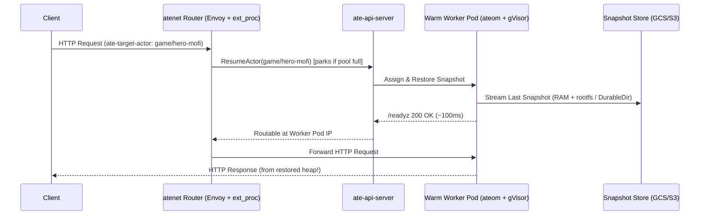

# Talk Outline: "Running Anything *But* Agents on Agent Substrate"

## CFP Abstracts

### KubeCon Version (Humanized — your voice + KubeCon detail)

> Agent Substrate is for Agents. It's in the name. Or is it?
>
> Substrate brings a lot of cool new primitives to Kubernetes: warm worker pools, gVisor and microVM memory snapshots, golden-image cloning, and wake-on-HTTP routing. None of these primitives actually care if your container is an AI agent.
>
> This session detaches Substrate from the agent view to see what happens when we use its fundamental building blocks for other workloads. We will run a game server with zero database where state lives purely in process RAM, clone slow-booting apps in milliseconds from a golden snapshot, and spin up one embedded database process per user.
>
> Some of these ideas are actually decent. Some of them, like suspending a Raft node and watching it split-brain when time jumps forward, are bad and should not be tried at home. Through this exercise of a solution looking for a problem, we will all gain a better understanding of how stateful checkpoint and restore works on Kubernetes, where it breaks, and why Substrate is such a great fit for agentic workloads.

### Single-Paragraph Version (Closest to your original draft)

> Agent Substrate is for Agents. It's in the name. Or is it? Substrate provides a lot of cool new primitives on Kubernetes, like warm worker pools, gVisor and microVM memory snapshots, instant cloning, and wake-on-HTTP routing, that can be used for things that are not agents at all. Some of these ideas are actually decent, such as skipping 30-second cold starts or running one embedded database per user. Some of them are bad and should not be tried at home, like running a game server with no database in RAM or suspending a Raft consensus node. This session will cover Substrate detached from the agent view and test its fundamental building blocks on other use cases. Through this exercise of a solution looking for a problem, we will all gain a better understanding of Substrate on Kubernetes and why it is such a great fit for agentic workloads.

---

## Narrative Arc & Timing (35–40 Minute Talk)

| Section | Title | Duration | Live Demo |
|---|---|---|---|
| **Act I** | **The Lie in the Name:** What Substrate Actually Is Under the Hood | 6 min | Architecture walkthrough |
| **Act II** | **Look Ma, No Database:** Turning `malloc()` into Durable Storage | 8 min | `act1-dungeon` (Zork RPG + Save-Scumming with `revert` & `tag`) |
| **Act III** | **Taming Real-World Monsters:** Cold-Start Cloners, Per-Tenant DBs & Deception Grids | 12 min | `act2-coldstart`, `act3-tenantdb`, `act4-honeypot` |
| **Act IV** | **Don't Try This at Home:** How to Break a Process Time-Machine | 7 min | `act5-timewarp` (Time-Jump Shock & Raft Split-Brain) |
| **Wrap-up** | **The "Secretly Agent-Shaped" Litmus Test** | 3 min | Decision matrix slide |

---

## Slide-by-Slide Outline & Speaker Notes

### Act I — The Lie in the Name (Slides 1–5)

* **Slide 1: Title Slide**
  * *Title:* Running Anything *But* Agents on Agent Substrate
  * *Subtitle:* Abusing a Stateful Sandbox Multiplexer for Fun, Profit, and Split-Brain Chaos
* **Slide 2: Why Kubernetes Pods Struggle with Bursty, Stateful Entities**
  * Kubernetes excels at long-lived services, not 1,000,000 idle single-tenant sandboxes that wake up for 200ms every 4 hours.
  * Traditional Serverless (Knative/Lambda) scales to zero by **killing your process**—forcing you to externalize every byte of state to Redis/Postgres and pay the full cold-start initialization tax on wakeup.
* **Slide 3: Strip Away the Word "Agent" — What Are the 5 Primitives?**
  1. **Warm `WorkerPool` Pods:** Pre-scheduled sandboxes (`gVisor` / `microVM`) waiting for an identity.
  2. **`ActorTemplate` Golden Snapshots:** Boot a heavy container once, wait for `/readyz` == `200 OK`, and freeze its memory + rootfs.
  3. **`Pause` & `Suspend` (`FULL` vs `DATA` scope):** Freeze process RAM (`Full`) and/or [`DurableDir`](#) volumes (`Data`) to local disk or GCS/S3.
  4. **Wake-on-HTTP (`atenet` + Request Parking):** Any request with `ate-target-actor: <atespace>/<actor>` transparently restores that exact memory image onto a free worker (or parks the request briefly if the pool is busy).
  5. **Time-Travel Primitives (`Tag` & `Revert`):** Tag a suspended snapshot to fork new actors (`--tag`), or call `kubectl ate revert` to throw away a crashed/mutated execution and rewind to the last snapshot.

---

### Act II — Look Ma, No Database! (Slides 6–9 + Live Demo 1)

* **Slide 6: What If We Stopped Writing Persistence Code Altogether?**
  * Think about how much code in a typical app exists just to translate in-memory structs into SQL rows or JSON blobs and back.
  * What if `main()` was just structs on the heap, and **the infrastructure checkpointed the heap**?
* **Slide 7: Live Demo 1 — The "Zero-Database" Dungeon (`cmd/dungeon`)**
  * **Show the code (`cmd/dungeon/main.go`):** Point out `type GameState struct`. No SQL driver, no `os.WriteFile`, no Redis client. Just a Go struct in RAM.
  * **On Stage (`./hack/stage-demo.sh act1-dungeon`):**
    1. Walk into the Armory, grab `dragon-slayer-sword` (intentionally leave `fire-shield` behind), walk into `dragon-lair`.
    2. **Quicksave:** `kubectl ate suspend actor hero-mofi -a anything-but-agents` and `kubectl ate create tag before-dragon -a anything-but-agents --actor hero-mofi`.
    3. **Die horribly:** `curl .../?cmd=attack` -> The Heap Dragon breathes fire; `player_hp: 0, alive: false`.
    4. **Save-Scumming (`git reset --hard` for RAM):** Run `kubectl ate revert actor hero-mofi -a anything-but-agents`, then `curl .../?cmd=look`. You are alive at 100 HP again! Notice `pod_ip_history` shows the actor hopped across different Kubernetes worker pods without losing a single local variable.
    5. **Fork the Multiverse:** Create `hero-timeline-b` using `--tag before-dragon`—two parallel universes forked from the same process memory!

---

### Act III — Taming Real-World Non-Agent Monsters (Slides 10–16 + Live Demos 2, 3, 4)

* **Slide 10: Pattern 1 — The "Cold-Start Monster" Cloner (`cmd/coldstart`)**
  * *Real-world examples:* Legacy Enterprise Spring Boot/JVM apps that take 45s to boot; `rust-analyzer` / `gopls` language servers indexing a monorepo; Python scientific/quant models loading 2GB into RAM.
  * *The Trick:* Substrate's `ActorTemplate` waits for `wakeupProbe` (`/readyz`) before taking the **Golden Snapshot**. Put your 45-second warmup *before* `/readyz` flips to `200 OK`!
  * **Live Demo (`./hack/stage-demo.sh act2-coldstart`):**
    * Show that `coldstart` took `12,000ms` during template creation to sieve primes up to `1,000,000` and generate a random `golden_heap_fingerprint`.
    * Instantiate `clone-1` and `clone-2` and query them—both respond in ~100ms, share the **exact same `golden_heap_fingerprint`**, and have all `78,498` primes precomputed in RAM, while isolating their own post-fork mutations!

* **Slide 12: Pattern 2 — One Database Process Per Customer (`cmd/tenantdb`)**
  * *Real-world examples:* Per-tenant SQLite, DuckDB, or embedded analytical engines.
  * *Why Multi-Tenant DBs Hurt:* Noisy neighbors, row-level security bugs, painful per-tenant backup/restore, and complex GDPR deletion queries.
  * *The Substrate Hybrid (`onPause: FULL`, `onCommit: DATA` + `DurableDir`):*
    * Short idle (`Pause` on the node): `FULL` snapshot keeps the in-memory buffer pool hot.
    * Long idle (`Suspend` to GCS): `DATA` snapshot discards the heavy RAM heap and only uploads the compact `/data` `DurableDir` WAL! On next wakeup, the process cold-boots in milliseconds and replays `/data/wal.jsonl`.
    * **GDPR Right-to-be-Forgotten:** `kubectl ate delete actor db-acme` deletes the compute instance and its snapshot storage in one shot.

* **Slide 14: Pattern 3 — The "Truman Show" Deception Grid (`cmd/honeypot`)**
  * *Real-world examples:* High-interaction security honeypots, per-PR full-stack preview environments, CTF (Capture The Flag) challenge boxes per contestant.
  * *How it works:* Route each scanner IP (`honeypot-203-0-113-5`) to its own `gVisor` actor. They drop a rootkit in `/tmp/honeypot/rootkit.sh` and leave. You pay $0 while they're gone. When they return 3 weeks later, their sandbox wakes in 100ms with their rootkit still in `/tmp`, while every other IP sees a pristine Golden Snapshot!

---

### Act IV — Don't Try This at Home: Where the Wheels Fall Off (Slides 17–21 + Live Demo 5)

* **Slide 17: What Happens When You Freeze a Process, But Not the Universe?**
  * When `gVisor` or a `microVM` checkpoints a process, the process's CPU registers and RAM freeze at $t_0$.
  * When it restores at $t_0 + \Delta t$, **the process has no idea $\Delta t$ happened** until it reads the clock or the network!
* **Slide 18: Live Demo 5 — Wall-Clock Time-Jump Shock & Raft Split-Brain (`cmd/timewarp`)**
  * **On Stage (`./hack/stage-demo.sh act5-timewarp`):**
    * Start `raft-leader-1`. It runs a 100ms heartbeat loop and holds a 3-second leader lease in RAM (`InMemoryRaftRole = "LEADER (Term 1)"`).
    * Suspend `raft-leader-1` for 5 seconds, then `curl` it.
    * **BOOM:** The JSON response lights up with `PANIC: TIME-TRAVEL SHOCK & RAFT SPLIT-BRAIN DETECTED AFTER RESUME!`:
      * A single "100ms" tick observed a `5,000+ ms` gap.
      * Its heap still insists it is the `Term 1 LEADER`, even though its 3s lease expired 2 seconds ago while frozen in GCS.
      * Its naive rate-limiter (`tokens += elapsed * rate`) just minted 500 burst tokens in a single tick.
* **Slide 19: The Four Horsemen of Substrate Anti-Patterns**
  1. **Distributed Consensus Voters (etcd / Raft / Paxos):** Suspending a voter triggers leader elections; resuming it reintroduces a zombie leader with amnesia.
  2. **Wall-Clock-Naive Loops:** Heartbeats, TLS session tickets, OAuth token refreshers, and token-bucket rate limiters that don't clamp `time.Since(lastTick)`.
  3. **Always-On 60Hz Streams (FPS Game Servers, Kafka Brokers, Live Video Transcoding):** If duty cycle is 100%, multiplexing is `1:1`—you've just built Kubernetes Pods with extra steps and a massive GCS snapshot bill.
  4. **Stateless Fast-Boot Microservices:** If a Go binary boots in 5ms and holds no state, `Deployment` + Service load-balancing beats actor pinning every time.

---

### Wrap-Up — The "Secretly Agent-Shaped" Litmus Test (Slide 22)

| Question | If YES -> Substrate Superpower | If NO -> Stick to K8s `Deployment` / `StatefulSet` |
|---|---|---|
| **Are instances idle >90% of the time?** | 10x–100x worker multiplexing density + [Request Parking](#) | 1:1 worker pinning (no multiplexing gain) |
| **Is cold-boot init >2 seconds?** | `ActorTemplate` Golden Snapshot skips init forever | Fast cold boot doesn't need Golden Snapshot |
| **Is state awkward to serialize to an external DB?** | `FULL` snapshot freezes heap & rootfs in place | Stateless or already in external Postgres/Redis |
| **Is each instance naturally single-tenant / untrusted?** | Per-actor `gVisor` / `microVM` sandbox + `Atespace` | Multi-tenant stateless worker pool |
| **Does the process participate in quorum/consensus?** | **DO NOT RUN ON SUBSTRATE** (Split-Brain!) | Use `StatefulSet` |
