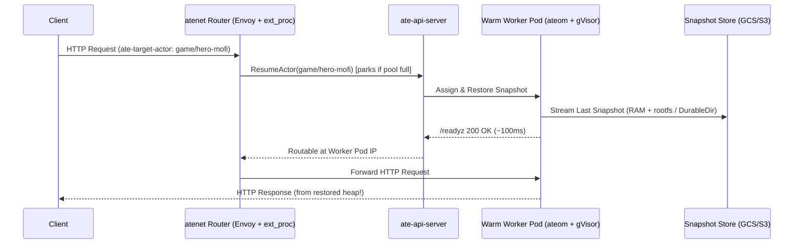

# Talk Outline: "Running Anything *But* Agents on Agent Substrate"

## Final CFP Abstract

> Agent Substrate is for agents. It is right there in the name. Or is it? Strip away the LLM orchestration frameworks, and what you are left with is a systems engineer's dream: an ultra-high-density, multi-tenant sandboxing platform built on Kubernetes that bypasses standard Pod lifecycle constraints.
>
> What happens when we hijack these primitives for workloads that have absolutely nothing to do with AI? In this talk, we will explore the limits of Substrate by utilizing its core building blocks: native process-level suspend/resume, rapid rehydration, and pod-decoupled scaling.
>
> Through this exercise of "unconventional systems-engineering design patterns" we'll look at the good ideas, the terrible ideas, and how pushing this infrastructure to its limits helps us all gain a better understanding of why these exact primitives make Substrate the perfect foundation for the agentic era.

## Additional Info (Notes for the Program Committee)

> The goal of this talk is to use Agent Substrate the "wrong" way so we can see how its Kubernetes primitives work without getting distracted by AI/LLM logic. By testing non-agent workloads on it, attendees learn both how stateful checkpoint/restore works under the hood and what makes agentic workloads unique.
>
> Candidate live demos we are exploring:
> - A game server where state lives purely in RAM across suspends and pod migrations, using snapshot revert to "save-scum."
> - Cloning slow-booting apps in ~100ms from Golden Snapshots, or running one isolated embedded database per user.
> - (Don't Try This at Home): Suspending a consensus/heartbeat node and watching it split-brain when wall-clock time jumps forward on resume.

---

## Narrative Arc & Timing (35–40 Minute Talk)

| Section | Title | Duration | Live Demo |
|---|---|---|---|
| **Act I** | **The Lie in the Name:** What Substrate Actually Is Under the Hood | 6 min | Architecture walkthrough |
| **Act II** | **Look Ma, No Database:** Turning `malloc()` into Durable Storage | 8 min | `act1-dungeon` (Zork RPG + Save-Scumming with `revert` & `tag`) |
| **Act III** | **Taming Real-World Monsters:** Cold-Start Cloners, Per-Tenant DBs & Deception Grids | 12 min | `act2-coldstart`, `act3-tenantdb`, `act4-honeypot` |
| **Act IV** | **Don't Try This at Home:** How to Break a Process Time-Machine | 7 min | `act5-timewarp` (Time-Jump Shock & Raft Split-Brain) |
| **Wrap-up** | **The "Secretly Agent-Shaped" Litmus Test** | 3 min | Decision matrix slide |

---

## Slide-by-Slide Outline & Speaker Notes

### Act I — The Lie in the Name (Slides 1–5)

* **Slide 1: Title Slide**
  * *Title:* Running Anything *But* Agents on Agent Substrate
  * *Subtitle:* Abusing a Stateful Sandbox Multiplexer for Fun, Profit, and Split-Brain Chaos
* **Slide 2: Why Kubernetes Pods Struggle with Bursty, Stateful Entities**
  * Kubernetes excels at long-lived services, not 1,000,000 idle single-tenant sandboxes that wake up for 200ms every 4 hours.
  * Traditional Serverless (Knative/Lambda) scales to zero by **killing your process**—forcing you to externalize every byte of state to Redis/Postgres and pay the full cold-start initialization tax on wakeup.
* **Slide 3: Strip Away the Word "Agent" — What Are the 5 Primitives?**
  1. **Warm `WorkerPool` Pods:** Pre-scheduled sandboxes (`gVisor` / `microVM`) waiting for an identity.
  2. **`ActorTemplate` Golden Snapshots:** Boot a heavy container once, wait for `/readyz` == `200 OK`, and freeze its memory + rootfs.
  3. **`Pause` & `Suspend` (`FULL` vs `DATA` scope):** Freeze process RAM (`Full`) and/or [`DurableDir`](#) volumes (`Data`) to local disk or GCS/S3.
  4. **Wake-on-HTTP (`atenet` + Request Parking):** Any request with `ate-target-actor: <atespace>/<actor>` transparently restores that exact memory image onto a free worker (or parks the request briefly if the pool is busy).
  5. **Time-Travel Primitives (`Tag` & `Revert`):** Tag a suspended snapshot to fork new actors (`--tag`), or call `kubectl ate revert` to throw away a crashed/mutated execution and rewind to the last snapshot.

---

### Act II — Look Ma, No Database! (Slides 6–9 + Live Demo 1)

* **Slide 6: What If We Stopped Writing Persistence Code Altogether?**
  * Think about how much code in a typical app exists just to translate in-memory structs into SQL rows or JSON blobs and back.
  * What if `main()` was just structs on the heap, and **the infrastructure checkpointed the heap**?
* **Slide 7: Live Demo 1 — The "Zero-Database" Dungeon (`cmd/dungeon` & `cmd/dungeon2d`)**
  * **Show the code (`cmd/dungeon/main.go` & `cmd/dungeon2d/actor.go`):** Point out `type GameState struct` / `type ActorSession struct`. No SQL driver, no `os.WriteFile`, no Redis client. Just a Go struct in RAM.
  * **CLI Walkthrough (`./hack/stage-demo.sh act1-dungeon`) & 2D Live Audience Game (`./hack/stage-demo.sh act1b-dungeon2d`):**
    1. Open the **Live Mission-Control Dashboard (`/dashboard`)** on the projector and scan the QR code to open the **2D Mobile Dungeon (`/play`)**.
    2. Walk around at 60fps in the browser (0 worker pods used while walking!). Clear Floor 1 (The Forgotten Crypt) and Floor 2 (Abandoned Armory) — watching the actor flash onto one of the 3 WorkerPool pods for ~100ms on each milestone and immediately suspend back to GCS.
    3. **Quicksave Shrine:** Step onto the Floor 2 Quicksave Shrine (`kubectl ate suspend` + `kubectl ate create tag`).
    4. **Die horribly on Floor 3:** Attack the Ancient Heap Dragon without the `fire-shield` -> The Heap Dragon breathes fire; `HP = 0, Alive = false`.
    5. **Save-Scumming (`git reset --hard` for RAM):** Tap **Revert Actor** on the phone (`kubectl ate revert actor`), restoring the Floor 2 GCS snapshot! Grab the `fire-shield`, defeat the Dragon, claim the `golden-chalice`, and escape through the Ascension Portal.
    6. **Fork the Multiverse:** Tap **Fork Timeline** (`--tag`)—two parallel universes forked from the same process memory!

---

### Act III — Taming Real-World Non-Agent Monsters (Slides 10–16 + Live Demos 2, 3, 4)

* **Slide 10: Pattern 1 — The "Cold-Start Monster" & Production HPA QPS Race (`cmd/coldstart`)**
  * *Real-world examples:* In-memory search/autocomplete services (`Zoekt`, `pkg.go.dev`), language servers (`rust-analyzer`, `gopls`), or JVM monoliths that build a ~76.6 MB in-memory index across 6 startup stages for 12+ seconds before `/readyz` turns `200 OK`.
  * *Why Cold Starts Kill Production QPS:* When a traffic spike (`15 -> 60 QPS`) triggers Kubernetes HPA (`1 -> 3` replicas, `20 QPS`/pod capacity on `coldstart_lb_qps`), newly scheduled Pods sit at `/readyz == 503` for 12+ seconds while Pod 1 drowns and sheds `40 QPS` (`429 Too Many Requests`).
  * *The Substrate Trick:* `ActorTemplate` waits for `wakeupProbe` (`/readyz`) before taking the **Golden Snapshot**—capturing the 50,000-doc inverted token & 3-gram search index once.
  * *Symmetrical 2-Hop Benchmark Architecture:* Both tracks route through a Kubernetes `Service` + L7 Router (`svc/coldstart-k8s-router` watching `Endpoints/coldstart-k8s` vs `svc/atenet-router` routing to `WorkerPool`) so HTTP/1.1 keep-alives are load-balanced per request on an identical network path.
  * **Live Demo (`./hack/stage-demo.sh act2-coldstart` + `/dashboard?key=<PRESENTER_TOKEN>`):**
    * Open the **Hardware Telemetry & Oscilloscope Rack UI** (authenticated via `Secret/coldstart-gateway` `PRESENTER_TOKEN`, with a top-right Moon/Sun **Projector Light Mode** toggle for auditorium screens).
    * Query `coldstart-1` and `coldstart-2` via the **Live Dual-Backend Search Probe** (`/api/probe`)—both wake in ~100ms, share the **exact same `golden_heap_fingerprint`**, and execute real BM25 + 3-gram searches (`~53,400` posting intersections across `50,000` indexed packages in `~15ms` of CPU/RAM work).
    * Trigger the **60 QPS Production HPA Spike** (`minReplicas: 1 -> maxReplicas: 3` on `coldstart_lb_qps`): watch the **6-Stage Index Warmup LED Matrix** and **HiDPI Goodput/429 Shed-Zone Oscilloscope** as Substrate wakes Actors 2 & 3 in ~100ms and serves `60 QPS` immediately while Standard K8s HPA remains stuck at `20 QPS` (shedding `40 QPS` as `429`) for 12 seconds (**~2x more total successful queries served**).

* **Slide 12: Pattern 2 — One Database Process Per Customer (`cmd/tenantdb`)**
  * *Real-world examples:* Per-tenant SQLite, DuckDB, or embedded analytical engines.
  * *Why Multi-Tenant DBs Hurt:* Noisy neighbors, row-level security bugs, painful per-tenant backup/restore, and complex GDPR deletion queries.
  * *The Substrate Hybrid (`onPause: FULL`, `onCommit: DATA` + `DurableDir`):*
    * Short idle (`Pause` on the node): `FULL` snapshot keeps the in-memory buffer pool hot.
    * Long idle (`Suspend` to GCS): `DATA` snapshot discards the heavy RAM heap and only uploads the compact `/data` `DurableDir` WAL! On next wakeup, the process cold-boots in milliseconds and replays `/data/wal.jsonl`.
    * **GDPR Right-to-be-Forgotten:** `kubectl ate delete actor db-acme` deletes the compute instance and its snapshot storage in one shot.

* **Slide 14: Pattern 3 — The "Truman Show" Deception Grid (`cmd/honeypot`)**
  * *Real-world examples:* High-interaction security honeypots, per-PR full-stack preview environments, SaaS webhook/plugin runners, CTF (Capture The Flag) challenge boxes per contestant.
  * *Split-Screen Live Demo (`./hack/stage-demo.sh act4-honeypot` + In-Cluster Gateway `deploy-honeypot` / `:8084`):*
    * **Left Pane ("The Movie Set" — Attacker View `/shell`):** Route each scanner IP (`honeypot-203-0-113-5`) to its own `SANDBOX_CLASS_GVISOR` actor (`debian:13-slim` base image in `.ko.yaml`) running real `/bin/sh -c` commands. The attacker sees only realistic `AcmeCorp Internal Payroll v1.4` `stdout`/`stderr` and decoy lures (`payroll_db_credentials.env.bak`, `wire_transfer_batch_409.csv`).
    * **Right Pane ("The Director's Booth" — Hidden SOC View `/forensics`):** Silently tracks in-memory `canary_alerts`, SHA-256 `rootfs_delta` (`UNCHANGED` / `ADDED` / `MODIFIED` / `DELETED`), `gvisor_sandbox_proof` (`Linux version 4.19.0-gvisor #1 SMP`), and cross-pod `pod_ip_history`.
    * **Auto-Checkpoint, $0 Idle Suspend & Un-deleting `rm -rf`:** When Attacker A steals decoy credentials and plants `/tmp/honeypot/dropper.sh`, the SOC Gateway auto-checkpoints (`/checkpoint/save` + `kubectl ate suspend actor`) to GCS ($0 idle compute) while Attacker B (`198.51.100.9`) sees a clean Golden Snapshot. Weeks later, Attacker A returns, wakes in ~100ms (even across different GKE worker pod IPs!) with `dropper.sh` still in `/tmp`, and runs `rm -f dropper.sh` to wipe their tracks—and the SOC Director uses **`kubectl ate revert actor`** to rewind the rootfs overlay and recover the deleted malware, or **`kubectl ate create tag` + `--tag`** to fork the live sandbox into `honeypot-forensic-lab` without tipping off the attacker!
    * **Attendee Takeaway:** `SANDBOX_CLASS_GVISOR` + `SNAPSHOT_CONTENT_SCOPE_FULL` solves the multi-tenant untrusted-code trilemma (VM-grade isolation, $0 idle cost, ~100ms wakeup), while `revert` and `--tag` act as a filesystem + RAM time machine and live Copy-on-Write process cloner for debugging stateful sessions.

---

### Act IV — Don't Try This at Home: Where the Wheels Fall Off (Slides 17–21 + Live Demo 5)

* **Slide 17: What Happens When You Freeze a Process, But Not the Universe?**
  * When `gVisor` or a `microVM` checkpoints a process, the process's CPU registers and RAM freeze at $t_0$.
  * When it restores at $t_0 + \Delta t$, **the process has no idea $\Delta t$ happened** until it reads the clock or the network!
* **Slide 18: Live Demo 5 — Wall-Clock Time-Jump Shock & Raft Split-Brain (`cmd/timewarp`)**
  * **On Stage (`./hack/stage-demo.sh act5-timewarp`):**
    * Start `raft-leader-1`. It runs a 100ms heartbeat loop and holds a 3-second leader lease in RAM (`InMemoryRaftRole = "LEADER (Term 1)"`).
    * Suspend `raft-leader-1` for 5 seconds, then `curl` it.
    * **BOOM:** The JSON response lights up with `PANIC: TIME-TRAVEL SHOCK & RAFT SPLIT-BRAIN DETECTED AFTER RESUME!`:
      * A single "100ms" tick observed a `5,000+ ms` gap.
      * Its heap still insists it is the `Term 1 LEADER`, even though its 3s lease expired 2 seconds ago while frozen in GCS.
      * Its naive rate-limiter (`tokens += elapsed * rate`) just minted 500 burst tokens in a single tick.
* **Slide 19: The Four Horsemen of Substrate Anti-Patterns**
  1. **Distributed Consensus Voters (etcd / Raft / Paxos):** Suspending a voter triggers leader elections; resuming it reintroduces a zombie leader with amnesia.
  2. **Wall-Clock-Naive Loops:** Heartbeats, TLS session tickets, OAuth token refreshers, and token-bucket rate limiters that don't clamp `time.Since(lastTick)`.
  3. **Always-On 60Hz Streams (FPS Game Servers, Kafka Brokers, Live Video Transcoding):** If duty cycle is 100%, multiplexing is `1:1`—you've just built Kubernetes Pods with extra steps and a massive GCS snapshot bill.
  4. **Stateless Fast-Boot Microservices:** If a Go binary boots in 5ms and holds no state, `Deployment` + Service load-balancing beats actor pinning every time.

---

### Wrap-Up — The "Secretly Agent-Shaped" Litmus Test (Slide 22)

| Question | If YES -> Substrate Superpower | If NO -> Stick to K8s `Deployment` / `StatefulSet` |
|---|---|---|
| **Are instances idle >90% of the time?** | 10x–100x worker multiplexing density + [Request Parking](#) | 1:1 worker pinning (no multiplexing gain) |
| **Is cold-boot init >2 seconds?** | `ActorTemplate` Golden Snapshot skips init forever | Fast cold boot doesn't need Golden Snapshot |
| **Is state awkward to serialize to an external DB?** | `FULL` snapshot freezes heap & rootfs in place | Stateless or already in external Postgres/Redis |
| **Is each instance naturally single-tenant / untrusted?** | Per-actor `gVisor` / `microVM` sandbox + `Atespace` | Multi-tenant stateless worker pool |
| **Does the process participate in quorum/consensus?** | **DO NOT RUN ON SUBSTRATE** (Split-Brain!) | Use `StatefulSet` |
