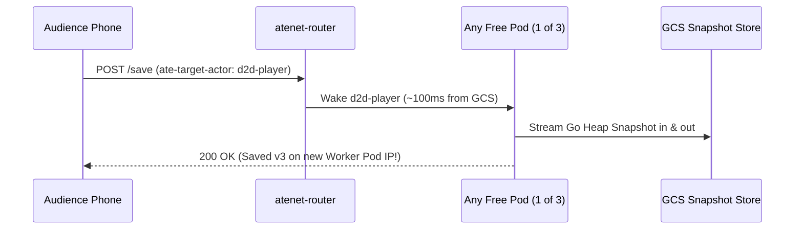

# Talk Outline: "Running Anything *But* Agents on Agent Substrate"

## Final CFP Abstract

> Agent Substrate is for agents. It is right there in the name. Or is it? Strip away the LLM orchestration frameworks, and what you are left with is a systems engineer's dream: an ultra-high-density, multi-tenant sandboxing platform built on Kubernetes that bypasses standard Pod lifecycle constraints.
>
> What happens when we hijack these primitives for workloads that have absolutely nothing to do with AI? In this talk, we will explore the limits of Substrate by utilizing its core building blocks: native process-level suspend/resume, rapid rehydration, and pod-decoupled scaling.
>
> Through this exercise of "unconventional systems-engineering design patterns" we'll look at the good ideas, the terrible ideas, and how pushing this infrastructure to its limits helps us all gain a better understanding of why these exact primitives make Substrate the perfect foundation for the agentic era.

## Stage Philosophy (20 Minutes Total)

1. **Welcome (`slide-01`) + Conference Rebel Hook (`slide-02`):** Greet the room on a clean `ATECon` cover slide with the **Yolo** mascot, talk title, and speaker byline (`slide-01`), then advance to `slide-02` to note that every other talk today is about agents or how Agent Substrate works for agents, so we are running **five non-AI workloads** on a single **3-pod WorkerPool** (`manifests/workerpool.yaml.tmpl`) and keeping the surprise that this slide deck itself runs on Substrate until the end.
2. **Collect One Puzzle Piece Per Demo:** Keep a tight, repeatable 3-beat rhythm for all 5 demos:
   - **Setup Slide (`slide-03, 05, 07, 09, 11`, ~15s):** Why a lazy/rebellious systems engineer built this non-agent app.
   - **Live Show-Don't-Tell (~2m):** Click through the live UI so the room sees the behavior firsthand.
   - **Puzzle Piece Recap Slide (`slide-04, 06, 08, 10, 12`, ~35s):** Name the exact Agent Substrate feature we just pocketed (`PUZZLE PIECE 01 / 05` .. `05 / 05`).
3. **The 3-Stage Jigsaw Epiphany (`slide-13` .. `slide-16`):** Put all 5 non-agent features on a `3×3` interlocking jigsaw board (`slide-13`), flip those 5 pieces over to reveal that each one solves a core agent runtime requirement (`slide-14`), animate in the **3 built-in Agent Substrate security/platform pieces** (`ActorEgressPolicy`, `ate-secret://`, `OpenFGA` + `microVM`/CSI) one by one before pausing and dropping the **center keystone (`Model + agent loop`)** into place (`slide-15`), and close with the reveal that even the 16-slide presentation deck ran on those same 3 pods (`slide-16`).

```mermaid
flowchart LR
    Open["00:00 Welcome + Rebel Open (1.5m): Yolo + 5 Non-AI Workloads"]
    D1["01:30 Piece 01 (3.2m): Dungeon 2D (RAM Save, Revert & Fork)"]
    D2["04:45 Piece 02 (3.2m): Coldstart Search (100ms Golden Clone)"]
    D3["08:00 Piece 03 (3.0m): TenantDB (DurableDir & Tiered Suspend)"]
    D4["11:00 Piece 04 (3.5m): Honeypot (gVisor & Rootfs Revert)"]
    D5["14:30 Piece 05 (3.2m): Timewarp (Turn-Based & Indefinite Wait)"]
    Close["17:45 Jigsaw Epiphany (2.2m): 5 Flips + 3 Substrate + Model = Agent"]

    Open --> D1 --> D2 --> D3 --> D4 --> D5 --> Close
```

## 20-Minute Run of Show

| Time | Segment | Duration | Slides & Live Screen | Puzzle Piece / Substrate Primitives |
|---|---|---|---|---|
| `00:00` | **Welcome & Rebel Cold Open: Five Non-Agent Workloads** (`cmd/slides`) | `1.5 min` | `slide-01` (Yolo Welcome) → `slide-02` + QR | 3-pod `WorkerPool` multiplexing (save the 16-slide deck reveal for `slide-16`!) |
| `01:30` | **Demo 1: "I Was Too Lazy to Set Up Postgres"** (`cmd/dungeon2d`) | `3.2 min` | `slide-03` → `dungeon.substrate.learngke.dev` → `slide-04` | **Piece 01/05:** `SNAPSHOT_FIDELITY_MEMORY`, `revert`, `create tag` (`--tag`) |
| `04:45` | **Demo 2: "Racing Kubernetes HPA on a 12s Cold Start"** (`cmd/coldstart`) | `3.2 min` | `slide-05` → `coldstart.substrate.learngke.dev` → `slide-06` | **Piece 02/05:** `ActorTemplate` + `wakeupProbe` `goldenTag` (~100ms clone) |
| `08:00` | **Demo 3: "Giving Every Customer Their Own DB Process"** (`cmd/tenantdb`) | `3.0 min` | `slide-07` → `tenantdb.substrate.learngke.dev` → `slide-08` | **Piece 03/05:** `DurableDir` (`/data`), async vs. sync suspend, `delete actor` |
| `11:00` | **Demo 4: "A Disposable Linux Sandbox Per Attacker IP"** (`cmd/honeypot`) | `3.5 min` | `slide-09` → `honeypot.substrate.learngke.dev` → `slide-10` | **Piece 04/05:** `gVisor` Sentry sandbox, rootfs overlay + forensic `revert`/`--tag` |
| `14:30` | **Demo 5: "Putting a Raft Leader in the Freezer"** (`cmd/timewarp`) | `3.2 min` | `slide-11` → `timewarp.substrate.learngke.dev` → `slide-12` | **Piece 05/05:** Turn-based `atenet` Wake-on-HTTP, request parking & indefinite wait |
| `17:45` | **The Jigsaw Epiphany: "Wait... We Built an Agent"** (`cmd/slides`) | `2.2 min` | `slide-13` (Loot) → `slide-14` (Flip) → `slide-15` (9/9) → `slide-16` | `+ ActorEgressPolicy` + `ate-secret://` + `OpenFGA`/`microVM` + `Model & Loop` |

## Pre-Stage Setup Checklist

1. **Cluster & Golden Snapshots (`v1.0.0`):** Confirm `kubectl get workerpool anything-but-agents -n anything-but-agents` shows `3/3` ready `ateworker-gvisor` pods and `kubectl ate get actor-templates -a anything-but-agents` has `goldenTag` populated on all templates.
2. **Browser tabs pre-opened left-to-right (sign in once with Google on Tab 0 to unlock all 6 tabs via cross-subdomain SSO, click the top-right Sun icon for Projector Light Mode if the room is bright, and press `H` on Tab 0 to hide the top bar and bottom Substrate HUD until the `slide-16` reveal):**
   - Tab 0: `https://abs.slides.substrate.learngke.dev/deck` (Live Slide Deck)
   - Tab 1: `https://dungeon.substrate.learngke.dev/dashboard` (with QR modal open!) + mobile `/play` tab
   - Tab 2: `https://coldstart.substrate.learngke.dev/dashboard`
   - Tab 3: `https://tenantdb.substrate.learngke.dev/dashboard`
   - Tab 4: `https://honeypot.substrate.learngke.dev/`
   - Tab 5: `https://timewarp.substrate.learngke.dev/dashboard`
3. **Clear stuck actors before walking on stage:** Run `./hack/stage-demo.sh act1-dungeon` once or check `kubectl ate get actors -a anything-but-agents` so all 3 worker slots start free.

## Minute-by-Minute Show Flow

### Welcome & Cold Open: The Conference Rebel (`00:00 - 01:30`, `slide-01` → `slide-02`)

* **On screen:** Walk on stage with `slide-01` ("Running anything *but* agents on Agent Substrate") on `abs.slides.substrate.learngke.dev/deck` featuring the **Yolo** mascot, talk title, and your name (`Mofi Rahman • Lead DevRel GKE, Google Cloud`). Advance (`→`) to `slide-02` ("Every talk today is about agents, so let's run *anything else*", showing the live `ate.dev` 120-actor multiplexer `.as-viz` on the right), then press **`Q`** (or click **Show QR (Q)**; press **`L`** anytime for the keyboard shortcuts legend) to pop up the scannable `dungeon.substrate.learngke.dev/play` QR modal before switching to Tab 1 (`dungeon2d` `/dashboard`).
* **Light spoken hook:**
  * *"We are at Agent Substrate Day, so every other talk today is about agents or how Agent Substrate works for agents. For the next 18 minutes, we are going to be rebels and run five workloads that have nothing to do with AI."*
  * *"We'll run a 2D game, a search engine, customer databases, an SSH honeypot, and a Raft cluster on one 3-pod WorkerPool, and keep one Agent Substrate feature from each demo."*
  * *(Keep the fact that this 16-slide presentation deck itself is running on Agent Substrate as a surprise reveal for `slide-16`!)*

### Demo 1: "I Was Too Lazy to Set Up Postgres" (`01:30 - 05:00`, `cmd/dungeon2d`)

* **The Joke / Setup (15s):**
  * *"Think about how much of our lives we waste turning Go structs into SQL rows before an HTTP request finishes, and turning SQL rows back into Go structs 200ms later. For Demo 1, I asked: what if I just... didn't use a database?"*
* **Show, Don't Tell (2m 15s live in Tab 1):**
  1. **Close the QR modal to reveal the Live Leaderboard:** Point at the screen: 20 to 50 people in the audience are playing an 8-floor roguelike right now, and all of them are sharing **3 pods** (`0` pods used while they run around at 60fps in the browser; an actor only wakes up for ~100ms when someone hits a Save Shrine!). Point out `pod_ip_history`: players hop from pod IP to pod IP between saves without losing a single gold coin.
  2. **Die on purpose:** Take your hero on Floor 8 straight into the **Ancient Heap Dragon** without fire protection -> `HP = 0`, dead on screen.
  3. **Save-Scum like a shameless gamer:** Click **Revert** (`kubectl ate revert actor d2d-mofi --snapshot-version`). Boom: alive again before the boss room! That was `git reset --hard` on live Go heap memory.
  4. **Cheat at a mutually exclusive choice:** Floor 6 has two locked chests and one key (`sunforged-aegis` vs. `voidbane-relic`). Click **Fork Timeline** (`--tag`) to clone your frozen memory into a parallel universe so you can open both.
* **What the Demo Does & What Substrate Gives Us (1m):**
  * **What the demo does:** Runs a multi-player 8-floor dungeon crawler where `100%` of server persistence is ordinary Go structs (`WorldState` / `ActorSession`) sitting in RAM, with zero SQL drivers, Redis clients, or files on disk.
  * **Features we get from Substrate:**
    * **`WorkerPool` + `atenet` Wake-on-HTTP:** An HTTP header (`ate-target-actor`) wakes a sleeping process on whichever of the 3 pods is free in ~100ms (and parks requests briefly if all 3 are busy), turning 3 pods into capacity for the whole room.
    * **Process Memory Checkpointing (`SNAPSHOT_FIDELITY_MEMORY`):** Freezes the Go heap and goroutine state to GCS when idle and restores it onto a totally different pod IP later.
    * **`kubectl ate revert` & `kubectl ate create tag` (`--tag`):** Infrastructure-level undo and branching timelines with zero application rollback code.

* **Transition joke to Demo 2:**
  * *"Okay, I can hear the backend engineers thinking: 'Cute game, Mofi, I don't run dungeons at work, I run serious stateless services behind HorizontalPodAutoscaler.' Great! Let's race."*

### Demo 2: "Cheating at the Autoscaling Olympics" (`05:00 - 08:30`, `cmd/coldstart`)

* **The Joke / Setup (15s):**
  * *"Who here runs a 'stateless' Java app, Python ML service, or search engine that takes 12+ seconds to boot before `/readyz` turns green? When traffic spikes, HPA panics and adds pods, and your new pods spend 12 seconds doing yoga while Pod 1 catches fire."*
* **Show, Don't Tell (2m 15s live in Tab 2):**
  1. **Show the contestants:** A real 50,000-package BM25 + trigram code search engine (~76 MB Go heap, capped at `20 QPS` per pod) that takes **12 seconds** across 6 startup stages to build its in-memory index. Click **Probe Both Backends** to show `coldstart-1` and `coldstart-2` returning real search hits with the **exact same `golden_heap_fingerprint`**.
  2. **Hit the `60 QPS` Spike button (`1 -> 3` replicas):** Watch the oscilloscope and 6-stage LED matrix live!
     * **Top track (Standard K8s HPA):** Pods 2 and 3 fail `readinessProbe` and stay **`0/1 NotReady`** (excluded from Service `Endpoints`) while ticking through `Stage 1/6... 2/6...` for 12 seconds as Pod 1 sheds overflow with `429 Too Many Requests`.
     * **Bottom track (Substrate HPA):** Actors 2 and 3 wake up `1/1 Ready` in **~100ms** with the 50,000-doc index *already built in RAM*, jumping straight to `60 QPS` and serving ~2x the total queries!
* **What the Demo Does & What Substrate Gives Us (1m):**
  * **What the demo does:** Races standard Kubernetes HPA against Substrate under a `3x` traffic spike on a heavy 50,000-document in-memory search engine.
  * **Features we get from Substrate:**
    * **`ActorTemplate` + `wakeupProbe` Golden Snapshots:** Substrate runs the 12-second index build **once** when you register the template, waits for `/readyz == 200 OK`, and freezes that warm 76 MB heap into a Golden Snapshot (`goldenTag`).
    * **Cluster-Wide `fork()` & Pod-Decoupled Scaling:** Scaling from `1 -> 3` stamps out pre-warmed clones onto warm worker pods in ~100ms instead of repeating deterministic startup work on every scale-out event.

* **Transition joke to Demo 3:**
  * *"Photocopying 76 MB of read-only RAM is awesome. Know what is less awesome? Uploading 10,000 giant RAM caches to GCS every night when your SaaS customers go to bed."*

### Demo 3: "The Lazy DBA's Multi-Tenant SaaS" (`08:30 - 11:30`, `cmd/tenantdb`)

* **The Joke / Setup (15s):**
  * *"Every SaaS engineer has two nightmares: forgetting `WHERE tenant_id = ?` on a SQL query, and getting a GDPR 'delete all my data' ticket across 50 foreign-key tables on Friday at 4:55 PM. So I gave every customer their own private database binary... on our same 3 pods."*
* **Show, Don't Tell (2m live in Tab 3):**
  1. **Four DBs, Three Pods, Zero `tenant_id`:** Show `db-acme`, `db-globex`, `db-initech`, and `db-umbrella` multiplexing across the 3 worker slots. Every query is literally `SELECT * FROM tenant_records` because each tenant lives in its own isolated sandbox!
  2. **The Storage vs. RAM X-Ray:** Warm up `db-acme`'s `16.0 MB` RAM Buffer Pool. Click **Quick Suspend (`--mode=async`)** -> query it: `HOT_RAM_RESUME` (the 16 MB cache stayed hot!). Now click **Cold Hibernate (`--mode=sync`)** -> watch the 16 MB scratch cache evaporate so only the **`~480 B` `/data/wal.jsonl`** uploads to GCS (**`99.997%` bandwidth saved**!), replaying in `<1ms` on the next click.
  3. **The Friday 4:55 PM GDPR Button:** Acme Corp churns and demands GDPR deletion. Click **GDPR Shred** (`kubectl ate delete actor db-acme`): compute, RAM snapshots, and `/data` volume are vaporized in one command (`404 TENANT_SHREDDED`) while `db-globex` next door doesn't drop a beat.
* **What the Demo Does & What Substrate Gives Us (45s):**
  * **What the demo does:** Runs a dedicated embedded database + 16 MB buffer pool per SaaS customer without Kubernetes PVC attach bottlenecks or giant object-storage bills.
  * **Features we get from Substrate:**
    * **`DurableDir` Micro-Volumes (`volumes: [{durableDir: {}}]`):** Snapshot-backed `/data` directories that attach and detach in ~100ms across thousands of tenants (unlike K8s PVCs, which cap out at tens per node and take seconds/minutes to mount).
    * **`SNAPSHOT_FIDELITY_MEMORY` vs. Native `SNAPSHOT_FIDELITY_VOLUMES`:** Keep RAM warm during active bursts (`tenantdb` template with `--mode=async`), or use native `SNAPSHOT_FIDELITY_VOLUMES` (`tenantdb-volumes` template) / `--mode=sync` so Substrate snapshots only `/data/wal.jsonl` (`~480 B`, `99.997%` GCS bandwidth saved) and replays WAL in `<1ms` when PID 1 boots fresh on wakeup.
    * **1-Command Tenant Shredding (`kubectl ate delete actor`):** Per-customer blast radius and instant cryptographic/storage cleanup.

* **Transition joke to Demo 4:**
  * *"Acme and Globex were polite paying customers. What happens when the user connecting to your app is an active hacker running `rm -rf`?"*

### Demo 4: "The Truman Show for Hackers" (`11:30 - 15:00`, `cmd/honeypot`)

* **The Joke / Setup (15s):**
  * *"Security honeypots usually suck: real VMs cost a fortune to leave idle, and fake Python shell emulators fool nobody. With Substrate, every sketchy IP address gets its own private *Truman Show* movie set."*
* **Show, Don't Tell (2m 30s live in Tab 4):**
  1. **Clean Shell First → Open "Director View" (`Ctrl+\`):** Tab 4 starts collapsed as a clean `payroll-admin-prod-01 — /bin/sh` terminal window (click **Reset Stage** beforehand if rehearsing so the actor starts at a pristine `v1`). Pretend to be Attacker `203.0.113.5`: run real `/bin/sh` commands (`id && uname -a`, `cat payroll_db_credentials.env.bak`, and drop `/tmp/honeypot/rootkit.sh`). Now click **Director View** in the top bar: the terminal slides left into "The Movie Set" and reveals "The Director's Booth" on the right—showing silent `gVisor` kernel proof, Canary alerts, `ActorEgressPolicy` + `ate-secret://` MITM proof, SHA-256 `rootfs_delta`, every audited command in Go heap RAM, and an automatic `v2`/`v3` GCS checkpoint (`$0` idle cost while a second attacker IP gets a clean box!).
  2. **The Attacker Panics (`rm -f` or `kill -9 1`):** Reconnect as `203.0.113.5` (it wakes in ~100ms on a *different* pod IP with `dropper.sh` still sitting in `/tmp`!). Run `rm -f dropper.sh` to destroy the evidence (or `kill -9 1` to crash PID 1 into `STATE=CRASHED`). The SOC pane flashes `ANTI_FORENSIC_WIPE_ATTEMPT (DELETED)` (or `STATE=CRASHED` with `atenet` refusing wakeup).
  3. **Un-deleting `rm -rf`, Recovering `STATE=CRASHED`, & Secret Cloning:** Click **Revert Wipe** (`kubectl ate revert actor`) in the SOC booth -> the container rewinds from `RUNNING` or `CRASHED` back to its pre-wipe snapshot and **`dropper.sh` pops right back onto disk**! Then click **Clone to Forensic Lab** (`--tag`) to spin up an identical copy of the compromised container for malware detonation while the hacker keeps typing on the left, totally clueless.
* **What the Demo Does & What Substrate Gives Us (45s):**
  * **What the demo does:** Gives every attacker IP a dedicated Linux shell environment with `$0` idle cost, invisible SOC telemetry, outbound C2 containment, un-deletable evidence, and live sandbox cloning.
  * **Features we get from Substrate:**
    * **Native `gVisor` Isolation (`sandboxClasses: [gvisor]`):** Real `/bin/sh` Linux binaries trapped inside a user-space application kernel (`ateworker-gvisor`), solving the VM-security vs. `$0`-idle vs. 100ms-wakeup trilemma.
    * **Rootfs Overlay + RAM Persistence:** Even ephemeral `/tmp` edits survive suspend/resume across different GKE worker pods without a PVC.
    * **Zero-Trust Egress (`ActorEgressPolicy` + `ate-secret://` MITM Injection):** Outbound C2 exfiltration (`curl`) is blocked by default at `atenet-egress`, and environment variables hold only `ate-secret://` URI placeholders (`trustBundles: [egress-mitm.ate.dev]`), so real tokens never enter actor RAM or GCS snapshots.
    * **Forensic Time-Travel (`revert` + `--tag`) & `STATE=CRASHED` Recovery:** Rewind destructive filesystem mutations, recover an actor whose PID 1 exited non-zero (`STATE=CRASHED`), or fork a live container Copy-on-Write to debug/inspect it safely on the side.

* **Transition joke to Demo 5 (Maximum Hubris):**
  * *"Pause and admire our ego right now. We deleted Postgres! We humiliated HPA! We solved GDPR and un-deleted `rm -rf`! At this point every engineer in the room has the same intrusive thought: 'Put EVERYTHING on Substrate! Let's put `etcd` and Raft on Substrate so our control plane scales to zero!' ... Let's watch how fast that ruins your weekend."*

### Demo 5: "Putting Raft in the Freezer" (`15:00 - 18:30`, `cmd/timewarp`)

* **The Joke / Setup (15s):**
  * *"You don't really understand a shiny new hammer until you smash your own thumb with it. Let's freeze the leader of a distributed consensus cluster."*
* **Show, Don't Tell (2m 15s live in Tab 5):**
  1. **Happy Cluster:** `raft-node-1..3` are up. `raft-node-1` is `LEADER (Term 1)` with a 3-second lease; Alice holds exclusive lock `#101`. Both clocks tick together.
  2. **Put Leader 1 in the Freezer:** Click **Suspend Term 1 Leader** (`kubectl ate suspend actor raft-node-1 --mode=sync`). Its CPU instructions drop to `0` and its heap clock freezes flat in amber. Count 3 seconds out loud: its lease expires in the real universe! `raft-node-2` and `raft-node-3` elect **`raft-node-2` as `LEADER (Term 2)`** and give exclusive lock `#102` to Bob.
  3. **Wake the Zombie:** Send a write from Mallory to `raft-node-1`. `atenet` cheerfully wakes `raft-node-1` up in 100ms! Because its frozen brain has no idea 5 seconds passed, three explosions happen in one tick:
     * **5,000ms Clock-Jump Shock** on a 100ms ticker.
     * **Dual-Leader Split-Brain:** `raft-node-1` still thinks it is `LEADER (Term 1)` and hands lock `#101` to Mallory while Bob holds `#102` on Node 2, corrupting the KV store on screen!
     * **Token-Bucket Jackpot:** `tokens += elapsed * rate` mints `+500` burst tokens at once.
  4. **The Seatbelt (`?guard=true`):** Toggle **Clock-Jump Guardrail ON** and replay: now on wakeup the process sees `dt >> 100ms`, immediately fences its stale lease (`409 Conflict`), and clamps its rate limiter.
* **What the Demo Does & Puzzle Piece #5 Grabbed (`slide-12`, 45s):**
  * **What the demo does:** Intentionally split-brains a 3-node Raft & distributed lock cluster by suspending its leader across a 3-second lease timeout.
  * **Puzzle Piece 05 / 05 we pocket from Substrate:**
    * **Turn-Based Execution & Indefinite Waits (`atenet` Wake-on-HTTP + Request Parking):** Breaking Raft shows the exact workload shape Substrate is built for. Heartbeat daemons (`etcd`, `Raft`, `Kafka`) expect continuous clocks and belong on `StatefulSets`. Substrate is built for **turn-based workloads** that execute a discrete unit of work, suspend cleanly, and **can wait indefinitely in Cloud Storage** until `atenet` parks the next HTTP request and wakes them in ~100ms.

### The Epiphany Finale: Snapping the 9-Piece Agent Puzzle Together (`17:45 - 20:00`, `slide-13` .. `slide-16`)

* **Step 1 — `slide-13` ("Five Substrate features we used without a single agent" — `puzzle_stage: "loot"`):**
  * Put all 5 non-agent demo jigsaw pieces onto the `3×3` board (`Dungeon 2D`, `Coldstart`, `TenantDB`, `Honeypot`, `Timewarp`) with 4 empty dashed cutouts remaining.
  * *"Look at the five features we pulled from our non-AI demos—including our realization from Timewarp that this runtime fits turn-based workloads that can wait indefinitely between turns. What workload needs all five of these together?"*
* **Step 2 — `slide-14` ("Hold on... every piece we used is what an *agent* needs" — `puzzle_stage: "epiphany"`):**
  * Press `→` (or click individual jigsaw tiles / **Flip 5 demo pieces** live on screen) to flip all 5 Rebel tiles into green **Agent Superpowers**:
    1. **Piece 01 (`Dungeon 2D` → Working memory & branching):** Roll back bad tool calls (`revert`) and fork plans (`--tag`).
    2. **Piece 02 (`Coldstart` → 100ms warm toolchains):** Pre-baked Python, Node, browser, and repo index ready instantly (`goldenTag`).
    3. **Piece 03 (`TenantDB` → Private `/workspace` per session):** Burst for 5 seconds, then sleep in GCS while idle (`DurableDir`).
    4. **Piece 04 (`Honeypot` → Safe untrusted code execution):** Contain prompt-injected `/bin/sh` inside `gVisor` and undo `rm -rf`.
    5. **Piece 05 (`Timewarp` → Human-paced agent turns):** Agents are turn-based workloads that can wait minutes or days for the next human reply (`atenet`).
  * Point at the 4 empty dashed jigsaw cutouts now asking: *"What drives the loop? Outbound network guard? Keep API keys out of RAM? Tenant authz & VM options?"*
* **Step 3 — `slide-15` ("Add Substrate's security layer and a *model* to get an agent" — `puzzle_stage: "complete"`):**
  * Press `→` and let the **3 `"ALSO IN SUBSTRATE"` pieces** animate in one by one to complete the 8-piece outer ring, followed by a clear beat before the **center keystone** drops in:
    * **3 `"ALSO IN SUBSTRATE"` platform/security pieces:**
      * **`ActorEgressPolicy` firewall:** Deny-by-default L7 HTTP & DNS egress rules.
      * **`ate-secret://` MITM credential injection:** Inject API keys at the egress proxy boundary so secrets never enter actor RAM or GCS snapshots.
      * **`OpenFGA` `AccessPolicy`, `microVM` (Kata) & CSI volumes:** Per-tenant authorization and hardware VM / storage options.
    * *(Pause on the open center slot)* → **1 Center Bullseye Keystone (`"YOU BRING THIS"`):** **`Model + agent loop`** (Gemini, Claude, or open weights + tools) drops in with a radial green shockwave!
  * **Final spoken punchline:**
    > *"Look at that 9-piece board. Eight of the nine pieces ship inside Agent Substrate out of the box. You drop your model and agent loop into the center—and that is why Agent Substrate is built for running agents."*
* **Step 4 — `slide-16` ("Thank you" — `asd-closing`):**
  * Press **`H`** to smoothly reveal the top bar and live Substrate telemetry footer—showing the room that even this 16-slide presentation deck has been running as 16 sleeping gVisor actors on that same 3-pod `WorkerPool`! Share the GitHub repo link for Q&A.

## Quick Reference: Demo-to-Substrate Feature Cheat Sheet

| Demo | What the Demo Does | Features We Get from Substrate (`v1.0.0`) |
|---|---|---|
| **0. `cmd/slides`** | Presentation deck where each slide (`slide-01..16`) is an actor sleeping in GCS | 16 sleeping slide actors, 0/3 workers held when idle, `SNAPSHOT_FIDELITY_MEMORY` heap views + `kubectl ate revert` + `asd-puzzle` finale |
| **1. `cmd/dungeon2d`** | Multi-player 8-floor browser roguelike with zero DB code | `WorkerPool` (`ate.dev/v1`), `atenet` Wake-on-HTTP, `SNAPSHOT_FIDELITY_MEMORY`, `save` / `--snapshot-version`, `revert`, `create tag` + `--tag` |
| **2. `cmd/coldstart`** | 50k-doc in-memory search engine in a `60 QPS` HPA race | `ActorTemplate` + `wakeupProbe` (`/readyz` -> `goldenTag` Golden Snapshot), ~100ms Copy-on-Write heap restore, pod-decoupled scaling |
| **3. `cmd/tenantdb`** | 1 isolated DB + 16 MB cache per customer across 3 pods | `DurableDir` (`/data`), `SNAPSHOT_FIDELITY_MEMORY` (`--mode=async`) vs. native `SNAPSHOT_FIDELITY_VOLUMES` (`tenantdb-volumes` / `--mode=sync`, `99.997%` GCS saved), 1-cmd `delete actor` |
| **4. `cmd/honeypot`** | Per-IP `gVisor` hacker Movie Set + SOC forensic booth | `sandboxClasses: [gvisor]` (`ateworker-gvisor`), OCI rootfs overlay + RAM persistence across pod IPs, `revert` (`rm -rf` undo & `STATE=CRASHED` recovery), `--tag` live clone, `ActorEgressPolicy`, `ate-secret://` MITM injection |
| **5. `cmd/timewarp`** | 3-node Raft cluster broken by a 5s leader freeze | Turn-driven `atenet` Wake-on-HTTP + request parking, wakeup clock-jump fencing (`?guard=true`), `Actor` vs. `StatefulSet` boundary |

## Complete Agent Substrate (`v1.0.0`) Feature Coverage Matrix

| Substrate Primitive | API / CLI Surface | Demonstrated In | How the Talk Uses It |
|---|---|---|---|
| **Pre-warmed Worker Pools** | `WorkerPool` (`ate.dev/v1`), `replicas: 3`, `sandboxClasses: [gvisor]` | All demos (`0`–`5`) | A single 3-pod pool multiplexes 16 slides, 50+ game players, 3 search replicas, 4 tenant DBs, per-IP honeypots, and 3 Raft nodes. |
| **Golden Snapshot Warm Boot** | `ActorTemplate` + `wakeupProbe` (`/readyz`) → `goldenTag` | `cmd/coldstart` (Demo 2) | Runs the 12-second 50k-document index build once at template registration, then stamps out pre-warmed clones in ~100ms during a `60 QPS` spike. |
| **Full Process Memory Checkpointing** | `SNAPSHOT_FIDELITY_MEMORY` (`gVisor` Sentry kernel + heap + rootfs overlay) | `cmd/slides`, `cmd/dungeon2d`, `cmd/coldstart`, `cmd/tenantdb`, `cmd/honeypot`, `cmd/timewarp` | Freezes ordinary Go structs, SQLite/WAL caches, and `/tmp` mutations in place without external Redis/Postgres serialization. |
| **Volume-Only Checkpointing** | `SNAPSHOT_FIDELITY_VOLUMES` + `volumes: [{durableDir: {}}]` | `cmd/tenantdb` (Demo 3, `tenantdb-volumes`) | Snapshots only `/data/wal.jsonl` (`~480 B`) while discarding the 16.0 MB rebuildable RAM cache (`99.997%` GCS savings) and replaying WAL in `<1ms` when PID 1 starts fresh on wakeup. |
| **Hot vs. Cold Suspend Modes** | `kubectl ate suspend actor --mode=async` vs. `--mode=sync` | `cmd/tenantdb` (Demo 3), `cmd/dungeon2d` (Demo 1) | `--mode=async` keeps the node-local memory checkpoint hot for instant bursts; `--mode=sync` flushes durable state to external GCS storage and releases the worker slot. |
| **Time-Travel Rollback (`RUNNING` & `CRASHED`)** | `kubectl ate revert actor <id> -a anything-but-agents` | `cmd/dungeon2d` (Demo 1), `cmd/honeypot` (Demo 4), `cmd/slides` (Demo 0) | Rewinds a dead roguelike hero to Floor 3, un-deletes an attacker's `rm -rf` wipe, or recovers an actor from `STATE=CRASHED` (when PID 1 exits non-zero and `atenet` refuses wakeup) back to its last known-good snapshot. |
| **Copy-on-Write Timeline Branching** | `kubectl ate create tag` + `kubectl ate create actor --tag <tag>` | `cmd/dungeon2d` (Demo 1), `cmd/honeypot` (Demo 4) | Forks a live player run into parallel A/B timelines (`-fork-b`) or clones a compromised hacker sandbox into a silent forensic lab copy while the attacker keeps typing. |
| **Wake-on-HTTP & Request Parking** | `atenet-router` (`:443` mTLS) + `X-Ate-Actor` / `ate://` | All demos (`0`–`5`) | Parks incoming HTTP requests while the target actor wakes from GCS in ~100ms on any free worker pod, then forwards the request with zero client retries. |
| **1-Command Tenant Shredding** | `kubectl ate delete actor <id> -a anything-but-agents` | `cmd/tenantdb` (Demo 3) | Cryptographically and physically purges a churning customer's compute, memory checkpoints, and `/data` volume in one call. |
| **Deny-by-Default L7/DNS Firewall** | `EgressPolicy` (`kubectl ate create egress-policy`) | `cmd/honeypot` (Demo 4) & Slide 15 | Blocks outbound C2 exfiltration (`curl https://c2.evil.example`) and lateral VPC movement at `atenet-egress` while permitting only allowlisted internal hostnames. |
| **MITM Egress Credential Injection** | `ate-secret://` + `replaceHeaders` + `systemInfo.trustBundle` (`egress-mitm.ate.dev`) | `cmd/honeypot` (Demo 4) & Slide 15 | Injects real Bearer tokens only at the outbound `atenet-egress` proxy boundary; actor env vars and GCS heap snapshots hold only inert `ate-secret://` URI handles. |
| **Per-Tenant Authorization & Hardware Sandboxes** | `AccessPolicy` (`OpenFGA`), `sandboxClasses: [microvm]` (Kata), CSI volumes | Slide 15 (`asd-puzzle` finale) | Completes the 8-piece outer security/platform ring around the central model + agent loop. |

## Defensive Q&A Playbook (Stage & Hallway Track)

### 1. Architecture & Demo Design

* **Q: Why does `dungeon2d` run 60fps movement and combat in the browser canvas instead of ticking every frame on the actor?**
  * **A:** Because ticking an idle or moving player at 60Hz on the server pins a worker pod `1:1`—which is the exact continuous-heartbeat anti-pattern we blow up in Demo 5 (`timewarp`)! By rendering frames client-side and calling the actor over `atenet` only on discrete turns (Save Shrines, Floor transitions, `revert`, `--tag` fork, and Victory), 50+ audience phones can play simultaneously on just 3 worker pods.
* **Q: Why does `coldstart` put a custom L7 endpoint router in front of the standard Kubernetes `Deployment` instead of using a normal `ClusterIP` Service?**
  * **A:** Fairness to Kubernetes! Go's HTTP client pools persistent HTTP/1.1 keep-alive connections, and standard `kube-proxy` iptables/IPVS rules only load-balance at TCP `SYN` time—meaning load generators stay pinned to Pod 1 even *after* Pods 2 and 3 finish booting. Giving K8s its own `Endpoints`-watching L7 router that spreads requests across all `1/1 Ready` pod IPs per request ensures the **only** difference on screen is the 12-second cold-start readiness gap vs. Substrate's ~100ms Golden Snapshot restore.

### 2. Checkpointing & Kernel Internals

* **Q: Why use `gVisor` (`ateworker-gvisor`) instead of standard Linux CRIU on `runc`?**
  * **A:** Two reasons: security and portability. First, you cannot run untrusted multi-tenant `/bin/sh` (`honeypot` or AI-generated code) safely on host-kernel `runc`. Second, CRIU on `runc` has to reconstruct host-kernel namespaces, PIDs, and open file descriptors that frequently collide when restoring across different nodes. Because `gVisor`'s Sentry is a user-space kernel written in Go, checkpointing serializes the entire virtualized kernel state, page tables, and rootfs overlay into one self-contained, node-independent snapshot.
* **Q: When would I pick `sandboxClasses: [gvisor]` vs. `sandboxClasses: [microvm]` (Kata Containers)?**
  * **A:** `gVisor` intercepts syscalls in user space with a tiny memory footprint and ~100ms snapshot restore, making it ideal for high-density Linux containers, code sandboxes, and language runtimes. `microvm` (Kata) wraps the actor in a hardware-virtualized guest kernel (KVM), which you choose when you need custom kernel modules, raw block devices, or strict hardware hypervisor isolation.
* **Q: What happens to open TCP connections when an actor suspends to GCS?**
  * **A:** Inbound HTTP traffic terminates at `atenet-router` (`:443` mTLS) and is forwarded over a fresh connection to whichever worker pod wakes the actor—so callers never see a broken socket. Outbound persistent TCP sockets (like an idle Postgres connection pool inside the actor) will freeze in the actor's network stack and eventually receive a `RST` or timeout from the remote peer if suspended for minutes or hours. Use stateless HTTP/gRPC calls or configure connection pools to reconnect lazily on wakeup.
* **Q: How do `CLOCK_REALTIME` and `CLOCK_MONOTONIC` behave across a gVisor snapshot/restore (`v7`), and why did `timewarp` strip monotonic readings with `.Round(0)`?**
  * **A:** When a gVisor container restores on a worker pod, wall-clock time (`CLOCK_REALTIME`) jumps forward immediately to match host UTC, whereas monotonic time (`CLOCK_MONOTONIC`) resumes from the saved kernel offset and syncs forward. In Go, `time.Now()` packs both a wall clock and a monotonic reading into `time.Time`, and `time.Since(t)` uses the monotonic delta when present. Stripping the monotonic reading with `.Round(0)` guarantees deterministic wall-clock delta measurement across both local multi-goroutine simulation and real gVisor checkpoints.

### 3. Storage, Fidelity & Crash Lifecycle

* **Q: What is the difference between `SNAPSHOT_FIDELITY_MEMORY` and `SNAPSHOT_FIDELITY_VOLUMES`?**
  * **A:** `SNAPSHOT_FIDELITY_MEMORY` checkpoints the entire process memory (Go heap, stacks, file descriptors, and rootfs overlay) so the process resumes at the exact instruction pointer where it paused. `SNAPSHOT_FIDELITY_VOLUMES` (`tenantdb-volumes`) checkpoints **only** the mounted `durableDir` volumes (`/data`) on suspend and boots the container's PID 1 fresh on resume with `/data` attached. Use `MEMORY` when your state lives in RAM or takes seconds to rebuild; use `VOLUMES` when your app already persists compact state to `/data` (like `tenantdb`'s 480-byte WAL) and you don't want to pay GCS storage/bandwidth for gigabytes of disposable RAM caches.
* **Q: What happens when PID 1 inside an actor crashes (`exit(1)` or `SIGKILL`)? Does Substrate `CrashLoopBackOff` like a Kubernetes Deployment?**
  * **A:** No! Unlike a stateless Kubernetes `Deployment` that blindly restarts a crashing pod in a loop (`CrashLoopBackOff`), an actor is a stateful identity. When PID 1 exits non-zero, Substrate transitions the actor to **`STATE=CRASHED`** and `atenet-router` **refuses** to auto-wake it so you don't corrupt durable state or spin in an infinite crash loop. To recover, the operator (or self-healing controller) runs `kubectl ate revert actor <id>`, which rewinds the actor from `CRASHED` back to `SUSPENDED` at its last known-good snapshot so the next request wakes it cleanly.

### 4. Zero-Trust Security (`ActorEgressPolicy` & `ate-secret://`)

* **Q: If you snapshot an actor's entire RAM to Google Cloud Storage, aren't all its API keys and database passwords sitting in plaintext inside the GCS memory dump?**
  * **A:** They would be if you passed raw secrets in environment variables! That's why Substrate has **MITM Egress Credential Injection (`ate-secret://`)**. Inside the actor (`honeypot`), `PAYROLL_API_TOKEN` is literally the string `ate-secret://k8s.io/default/anything-but-agents/payroll-vault-api/token`. If an attacker dumps `/proc/self/environ`, runs `env`, or inspects the GCS memory snapshot, they only see that useless URI handle. When the actor makes an allowed HTTPS call through `atenet-egress` (trusted via the injected `/run/ate/trust-bundle.pem` CA bundle), the egress proxy terminates TLS, swaps the `ate-secret://` header for the real Kubernetes Secret value on the wire, and forwards it only to the allowlisted hostname in the `EgressPolicy`.

### 5. Ecosystem Comparisons

* **Q: How is this different from Cloud Run / Knative scale-to-zero?**
  * **A:** When Cloud Run or Knative scales to zero, it sends `SIGTERM` and **destroys your process**. Every variable in RAM is wiped, and the next request pays the full 12-second cold boot from scratch. When Substrate scales to zero, it **pauses your process** to object storage and restores the live memory heap in ~100ms on any warm worker pod.
* **Q: How is this different from Cloudflare Durable Objects, AWS Lambda SnapStart, or Temporal?**
  * **A:** Durable Objects and Temporal are awesome, but they require rewriting your application against a proprietary JavaScript/V8 isolate API or deterministic workflow SDK. AWS Lambda SnapStart only snapshots at initialization time (like our Demo 2 `goldenTag`), not continuously between stateful user turns. Substrate runs unmodified Linux OCI containers (`/bin/sh`, Go, Python, Node, C binaries) and checkpoints both initial Golden Snapshots *and* ongoing per-turn state mutations.
* **Q: Why not WebAssembly (Wasm)?**
  * **A:** Wasm is great for pure compute filters, but try running unmodified `/bin/sh`, `git`, `python3` with C-extensions, headless Chromium, or an attacker's ELF binary inside Wasm without hitting POSIX syscall gaps. Substrate gives you a full Linux syscall ABI via `gVisor` or a full guest kernel via `microVM`.
